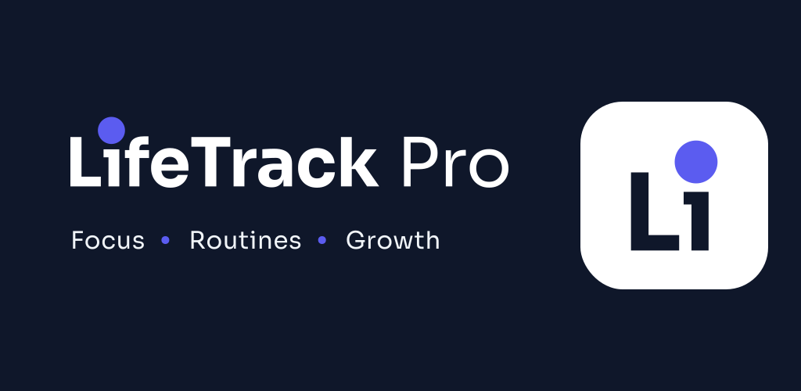
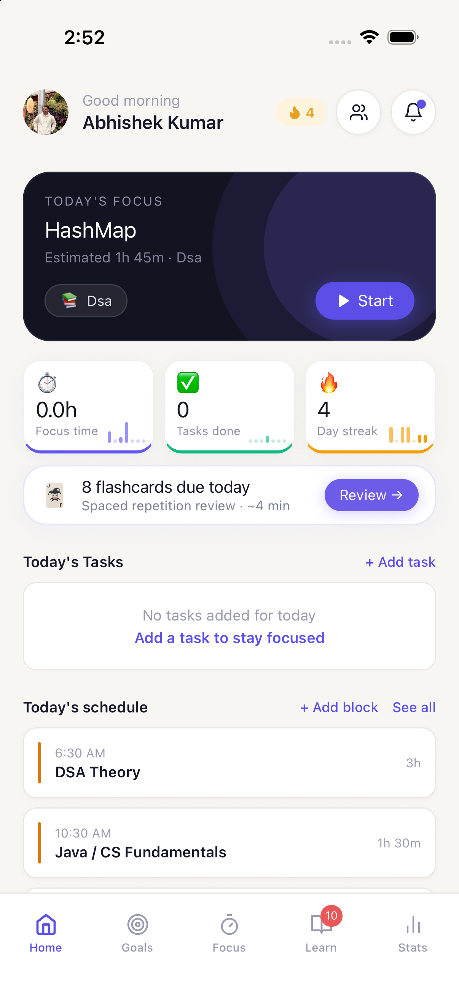
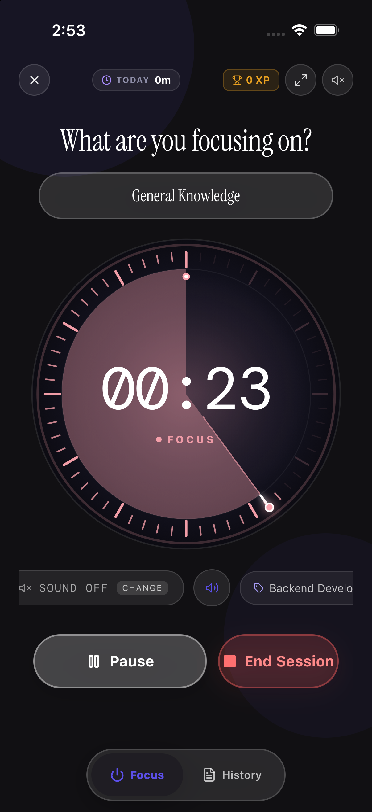
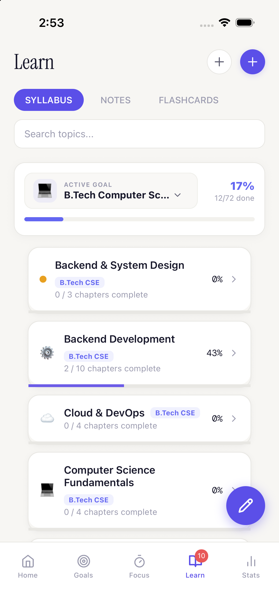
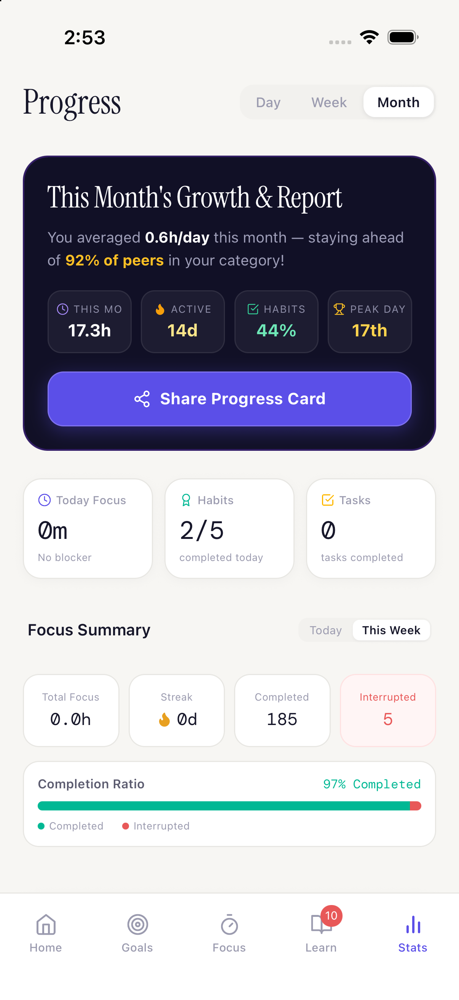
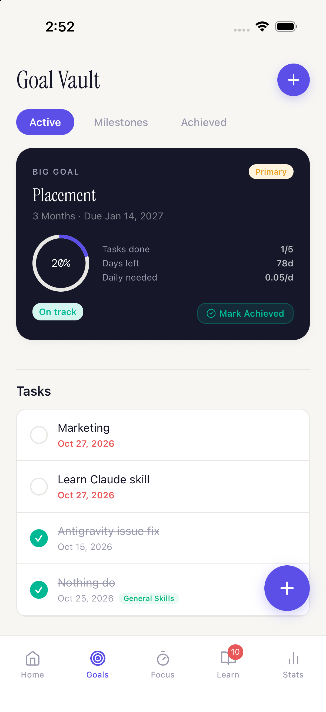
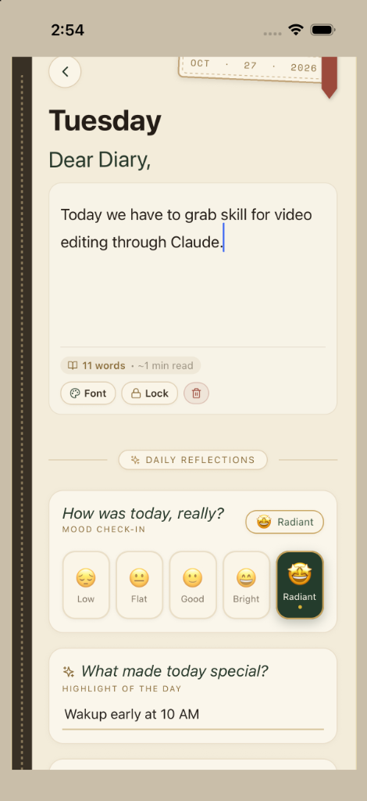
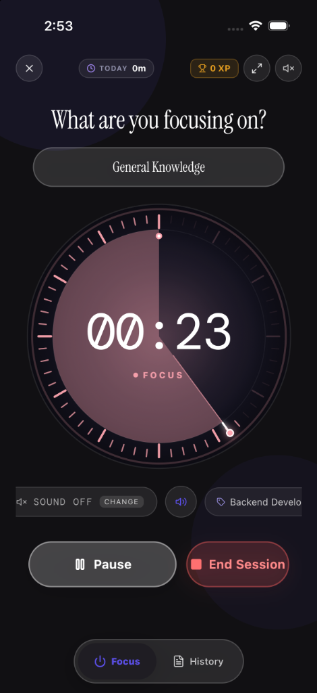

  

<h1 align="center">LifeTrack Pro</h1>

  <strong>The Unified Study & Life OS for Competitive Exam Aspirants</strong> 
  One disciplined operating system combining Smart Pomodoro, SM-2 Spaced Repetition, Habit Freeze Shields, and Virtual Study Rooms.

  
  
  
  

  <a href="https://play.google.com/store/apps/details?id=com.lifetrackpro.app"><b>📱 Get on Play Store</b></a> •
  <a href="https://lifetrackpro.in"><b>🌐 Explore Web App</b></a> •
  <a href="https://lifetrackpro.in/calculator"><b>🧮 Focus ROI Calculator</b></a> •
  <a href="https://chat.whatsapp.com/B8uwXjT9R665ahqcXVsZdk"><b>💬 WhatsApp Community</b></a>

---

  

---

## 📱 Mobile App Showcase

<table align="center" width="100%">
  <tr>
    <td width="33.3%" align="center" valign="top">
      
<b>Home & Daily Plan</b>

      
      
Unified dashboard with focus quotas, daily agenda & active streaks.

    </td>
    <td width="33.3%" align="center" valign="top">
      
<b>432Hz Focus Timer</b>

      
      
25/5 or 50/10 intervals with lockscreen foreground soundscapes.

    </td>
    <td width="33.3%" align="center" valign="top">
      
<b>Habit Streak Shields</b>

      
      
Discipline routines with emergency streak freeze shields for rest days.

    </td>
  </tr>
</table>

---

## ⚡ Core Productivity Systems

<table>
  <tr>
    <td width="58%" valign="top">
      <h3>1. Smart Pomodoro Focus Timer with Ambient Audio</h3>
      
Custom work and break intervals (25/5 or 50/10 deep work) coupled with science-backed acoustic soundscapes (432Hz binaural alpha tones, gentle rainfall, café hum, and lo-fi beats).

      <ul>
        <li><b>Persistent Foreground Service:</b> Audio and countdowns continue smoothly even when your phone screen is locked.</li>
        <li><b>Automated Focus Logging:</b> Every completed sprint is automatically credited to your subject distribution chart.</li>
        <li><b>Distraction Shield:</b> Fullscreen mode eliminates impulsive notification-checking during deep work.</li>
      </ul>
      

        <a href="https://lifetrackpro.in/features/pomodoro-timer"><b>Explore Focus Timer Documentation →</b></a>
      

    </td>
    <td width="42%" align="center" valign="middle">
      
    </td>
  </tr>
</table>

 

<table>
  <tr>
    <td width="42%" align="center" valign="middle">
      
    </td>
    <td width="58%" valign="top">
      <h3>2. Habit Streaks with Emergency Freeze Shields</h3>
      
Consistency beats sporadic intensity. Build non-negotiable daily routines protected by automated safety nets.

      <ul>
        <li><b>Streak Freeze Shields:</b> Unavoidable illness, travel, or post-exam rest? Automated freeze tokens absorb the gap without resetting your multi-month consistency streak.</li>
        <li><b>Minimum Daily Quotas:</b> Break massive syllabi into bite-sized commitments (e.g. 50 MCQs, 2 Mains Answer sets).</li>
        <li><b>Milestone Badges:</b> Celebrate consistency as you pass 7-day, 30-day, and 100-day milestones.</li>
      </ul>
      

        <a href="https://lifetrackpro.in/features/habit-tracker"><b>Explore Habit Tracker Features →</b></a>
      

    </td>
  </tr>
</table>

 

<table>
  <tr>
    <td width="58%" valign="top">
      <h3>3. Target Exam Syllabi Planners (JEE • NEET • UPSC)</h3>
      
Visual curriculum milestone trackers mapped directly to NCERT and official competitive examination patterns.

      <ul>
        <li><b>Chapter-Level Checklists:</b> Track completion percentages across Physics, Chemistry, Biology, Mathematics, and General Studies.</li>
        <li><b>Exam Countdown Timers:</b> Keep exam target dates front and center to pace your revision sprints.</li>
        <li><b>Weak Topic Flagging:</b> Pin high-weightage chapters for targeted spaced repetition reviews.</li>
      </ul>
      

        <a href="https://lifetrackpro.in/exams/jee"><b>JEE Planner</b></a> •
        <a href="https://lifetrackpro.in/exams/neet"><b>NEET Tracker</b></a> •
        <a href="https://lifetrackpro.in/exams/upsc"><b>UPSC Mains Timer</b></a>
      

    </td>
    <td width="42%" align="center" valign="middle">
      
    </td>
  </tr>
</table>

 

<table>
  <tr>
    <td width="42%" align="center" valign="middle">
      
    </td>
    <td width="58%" valign="top">
      <h3>4. Discipline Analytics & Study Heatmaps</h3>
      
Transform daily preparation hours into actionable proof. Measure your annual consistency with high-resolution telemetry.

      <ul>
        <li><b>GitHub-Style Study Heatmap:</b> Visualize every single day you put in focused work across the entire academic year.</li>
        <li><b>Subject Distribution Ratios:</b> Balance study sessions so you never over-index on favorite subjects while avoiding difficult ones.</li>
        <li><b>Study Hours ROI:</b> Calculate reclaimed focus hours and retention gains using scientific models.</li>
      </ul>
      

        <a href="https://lifetrackpro.in/calculator"><b>Launch Study ROI Calculator →</b></a>
      

    </td>
  </tr>
</table>

---

## 🗃️ Additional Student Tools

<table align="center" width="100%">
  <tr>
    <td width="33.3%" align="center" valign="top">
      
<b>Goal Vault & Milestones</b>

      
      
Map long-term rank targets, test series dates, and weekly milestone quotas.

    </td>
    <td width="33.3%" align="center" valign="top">
      
<b>Mindful Daily Reflections</b>

      
      
Evening mental check-ins to prevent burnout and reflect on daily wins.

    </td>
    <td width="33.3%" align="center" valign="top">
      
<b>Encrypted Personal Vault</b>

      
      
Store exam admit cards, formula sheets, and personal study notes securely.

    </td>
  </tr>
</table>

---

## 🎯 Target Aspirants & Preparation Workflows

- **🧬 NEET Medical Aspirants:** Active NCERT Biology recall with SM-2 flashcard intervals, rapid botany revision schedules, and high-stamina timed blocks.
- **🎯 IIT JEE Main & Advanced:** 90-minute full-length problem sprints, formula bank reviews, and physics concept checklists.
- **⚖️ UPSC Civil Services:** 7-minute mains answer-writing stopwatches, GS paper time allocation, and current affairs revision cycles.
- **💻 Software Engineering & Placements:** Timed LeetCode sprints, algorithmic flashcards, and non-negotiable coding habits.

---

## 🔒 Architecture & Privacy Philosophy

- **100% Offline-First:** All cards, timers, habits, and notes are stored locally on your device with zero cloud latency.
- **Zero Commercial Ads:** No video interruptions, no banners, and zero third-party tracking scripts.
- **Zero Data Mining:** Your study habits belong exclusively to you. We do not sell user data to advertising brokers.
- **Battery-Optimized:** Built with native foreground services engineered to draw minimal battery on Android 8.0+.

---

## 🌐 Official Platform & Community

- **Android App:** [Download on Google Play Store](https://play.google.com/store/apps/details?id=com.lifetrackpro.app)
- **Web Platform:** [https://lifetrackpro.in](https://lifetrackpro.in)
- **Study Time ROI Calculator:** [https://lifetrackpro.in/calculator](https://lifetrackpro.in/calculator)
- **Knowledge Base & FAQ:** [https://lifetrackpro.in/faq](https://lifetrackpro.in/faq)
- **WhatsApp Aspirant Community:** [Join Community Group](https://chat.whatsapp.com/B8uwXjT9R665ahqcXVsZdk)
- **Telegram Channel:** [@lifetrackpro](https://t.me/lifetrackpro)
- **Instagram:** [@lifetrackpro](https://www.instagram.com/lifetrackpro/)
- **LinkedIn:** [LifeTrack Pro](https://www.linkedin.com/company/lifetrackpro)

---

## 👨‍💻 Creator & Maintainer

Crafted with dedication by **[Abhishek Kumar](https://github.com/abhishekkumar74)** for serious students who believe that consistent daily discipline transforms aspirations into results.

  © 2026 LifeTrack Pro. All rights reserved.

